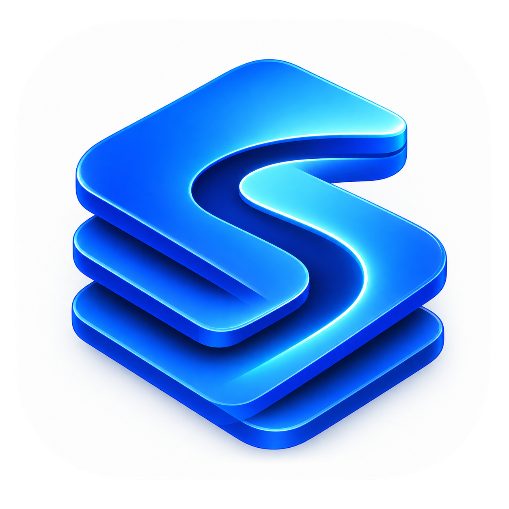
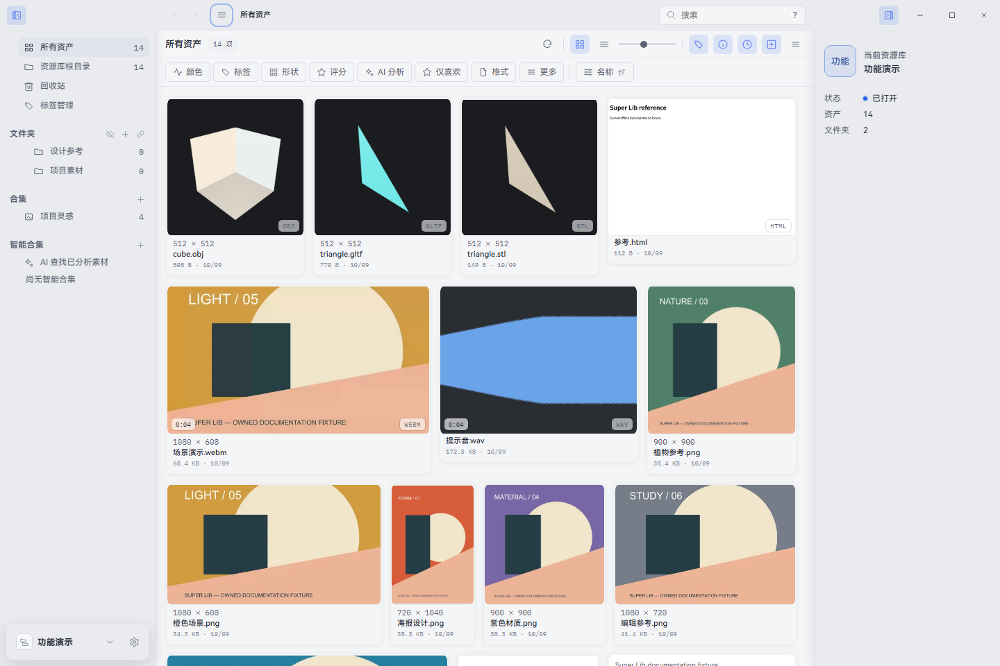

<div align="center">

**English** | [简体中文](README.md)

</div>

# Super Lib

<div align="center">



</div>

Super Lib is a free local asset manager for creative work. Browse images, videos, audio, and models in one workspace, organize them with folders, tags, color filters, and collections, and optionally add AI analysis and a custom appearance.

> **[Illustrated feature catalogue (Chinese)](docs/user-guide/features.md)**
> Each user-facing feature includes an entry point, instructions and limitations. Captures are labeled: released 2.3.17, isolated 2.3.18 development, or actual 2.3.19 package, all using fixture libraries. English task guides remain available below.

[Download for Windows](https://github.com/aimtowin/Super/releases/latest/download/SuperSetup.exe) · [Releases and other downloads](https://github.com/aimtowin/Super/releases/latest) · [Quick start](docs/user-guide/quick-start.en.md) · [Report a bug](https://github.com/aimtowin/Super/issues)



## Start with a local library

1. Download and install `SuperSetup.exe`, then open Super Lib.
2. Create a library at a location on a local disk. An SSD is recommended; leave room for assets and preview caches.
3. Optionally configure a provider in **Settings → AI** and customize themes, backgrounds, and text size in **Settings → Appearance**. Both steps can be skipped.
4. Import assets or link an existing folder, then start browsing and organizing.

Super Lib itself is free. Optional third-party AI services may charge according to their own pricing.

## Highlights

- **Multiple asset types**: manage images, video, audio, 3D models, text, and other recognized files. Unsupported preview types can still be catalogued and opened externally.
- **Organization and discovery**: folders, tags, ratings, favorites, descriptions, palettes, collections, filters, sorting, and full-text search within the current scope.
- **Local first**: managed imports copy assets into a library, while linked folders reference an external directory in place. Library data stays local and can be synchronized between devices through WebDAV when needed.
- **Browsing and preview**: thumbnails, video previews, metadata, the viewer, and background derivative work are designed not to block browsing.
- **Structure and personalization**: Markdown source/render switching, read-only ZIP member browsing and library-image folder covers; proximity viewer controls, fullscreen navigation and reversible hiding of missing links. See the [2.3.19 guide](docs/user-guide/basics.en.md#2319-viewers-and-organization).
- **Floating references**: keep the current image or PDF in a movable, resizable, always-on-top window while the main window minimizes. See [Floating preview](docs/user-guide/basics.en.md#floating-image-preview).
- **One hover-hint location**: control and asset-name hints appear in the lower-right bubble without duplicate near-pointer tooltips. See [Corner hint bubble](docs/user-guide/basics.en.md#hover-hints).
- **Readable filters and custom icons**: include/exclude modes with condition summaries, plus Emoji icons for folders, linked folders, collections and smart collections.
- **Automation and extensibility**: plugins, controlled automation scripts, and local MCP connections are supported. Writes are bounded by permissions, execution plans, and risk confirmation.
- **AI analysis and search**: generate descriptions and tags for supported media, then use natural language to find analyzed assets and create temporary smart collections. AI is optional and requires your own provider configuration.
- **Appearance**: light and dark themes, custom backgrounds, theme colors, and four application text-size levels.
- **External libraries**: supported external libraries can be opened directly.

## Install and use

The current source targets `v2.4.0`; verified Windows x64 release artifacts are documented in the [2.4.0 validation record](docs/releases/v2.4.0-validation.md). The update source is now reached by server IP (`https://43.142.93.106`); 2.4.0 ships only a full update ZIP and installer, with no delta packages. Download `SuperSetup.exe` for a first installation. Availability on other platforms depends on the files actually attached to a release.

See the [2.4.0 release notes](docs/releases/v2.4.0.md) for the IP-direct update source and the removal of older releases. The earlier [2.3.20 notes](docs/releases/v2.3.20.md) describe the sidebar loading fix, and [2.3.19](docs/releases/v2.3.19.md) documents the viewer and library-organization upgrades.

Libraries live at the location you choose. Importing copies assets into the library; linking references files at their existing location, which must remain accessible. See the [quick start](docs/user-guide/quick-start.en.md).

For installation, import, browsing, sync, AI, plugins, and troubleshooting guidance, see the [user guide](docs/user-guide/README.en.md).

## Feedback and license

Report bugs through [GitHub Issues](https://github.com/aimtowin/Super/issues) or through the social platform where the author shares Super Lib. Include your app version, reproduction steps, expected and actual behavior, and relevant screenshots. See [troubleshooting](docs/user-guide/troubleshooting.en.md).

Super Lib is free to use. Repository code is licensed under the [MIT License](LICENSE); third-party component and asset notices are in [THIRD_PARTY_NOTICES.md](THIRD_PARTY_NOTICES.md).

## Build locally

Node.js 24 is required (see `.nvmrc`). Native development targets macOS arm64 and Windows x64; do not build from an SMB/NAS-mounted path.

```bash
npm ci --registry=https://registry.npmjs.org
npm run rebuild:native
npm start
```

Common verification and packaging commands:

Packaging prerequisite: a clean checkout currently lacks `docs/internal/skills/super-automation/automation-api.d.ts`, which the packaged-runtime gate requires, and there is no usable public generation CLI. Without a matching declaration, `npm run package` fails its final gate. Do not bypass the gate or treat a private local declaration as a published SDK. Successful development startup or type checking does not establish a reproducible release build; see the [build preparation gap](docs/reference/known-issues-2.3.18.md#clean-checkout-build-gap).

```bash
npm run lint
npm run typecheck
npm run test
npm run test:e2e
npm run package
npm run make:inno
```

On Windows, `npm run make:inno` creates `out/make/inno/SuperSetup.exe`. Repository scripts and the [extension author manual](docs/manual/README.md) define the current build, delivery, and extension boundaries.

## Documentation

See the [2.4.0 release notes](docs/releases/v2.4.0.md) and [validation record](docs/releases/v2.4.0-validation.md) for current delivery. The [October 10 completion report](docs/reference/completion-results-2026-10-10.md), earlier batch reports and pre-fix snapshots retain their historical context.

| Document | Content |
| --- | --- |
| [Known issues](docs/reference/known-issues-2.3.18.md) · [Current documentation review](docs/reference/documentation-review-2.3.21.md) | Packaged Console failure, clean-checkout build preparation and verification boundaries |
| [Local release-tool timings (Chinese)](docs/reference/release-throughput-2026-10-12.md) | A local-only benchmark; optimized source is not yet in public main, and no new release or public CLI is implied |
| [Illustrated feature catalogue (Chinese)](docs/user-guide/features.md) | Real screenshots, entry points, instructions and limits for each user feature |
| [Post-development decisions and milestones (Chinese)](docs/POST_DEVELOPMENT_DECISIONS.md) | Decisions, 52 version milestones, 349 conversation entries, and outstanding work |
| [Phase 1 fixes (Chinese)](docs/reference/followup-phase1-results-2026-10-09.md) · [Phased upgrades](docs/plans/2026-10-09-followup-upgrades.md) | Historical checkpoint for eight reproduced fixes; current delivery status is in the completion results and release validation |
| [Pre-fix defect snapshot (Chinese)](docs/plans/confirmed-unfixed-2026-10-09.md) | Historical reproductions and safety warnings for the released 2.3.17 build |
| [Quick start](docs/user-guide/quick-start.en.md) | Installation, local library creation, optional setup, and first import |
| [Appearance](docs/user-guide/appearance.en.md) | Color modes, backgrounds, text size, and screenshots |
| [User guide](docs/user-guide/README.en.md) | Install, import, browse, search, tags, collections, sync, AI, plugins, and troubleshooting |
| [Extension author manual](docs/manual/README.md) | Plugin, automation-script, and MCP development guides and API references |
| [Product brief (historical planning)](docs/product-brief.md) | Product direction and early scope; use the user guide for current instructions |
| [Glossary](docs/glossary.md) | Definitions for libraries, automation, plugins, sync, and more |

License notices for third-party components, media runtimes, and assets are in [THIRD_PARTY_NOTICES.md](THIRD_PARTY_NOTICES.md) and the license files shipped with each component.

Acknowledgement and open-source license: Super Lib is independently developed on an open-source foundation. We thank the original authors and contributors, retain the required copyright notices, and continue to release the software under the [MIT License](LICENSE).
