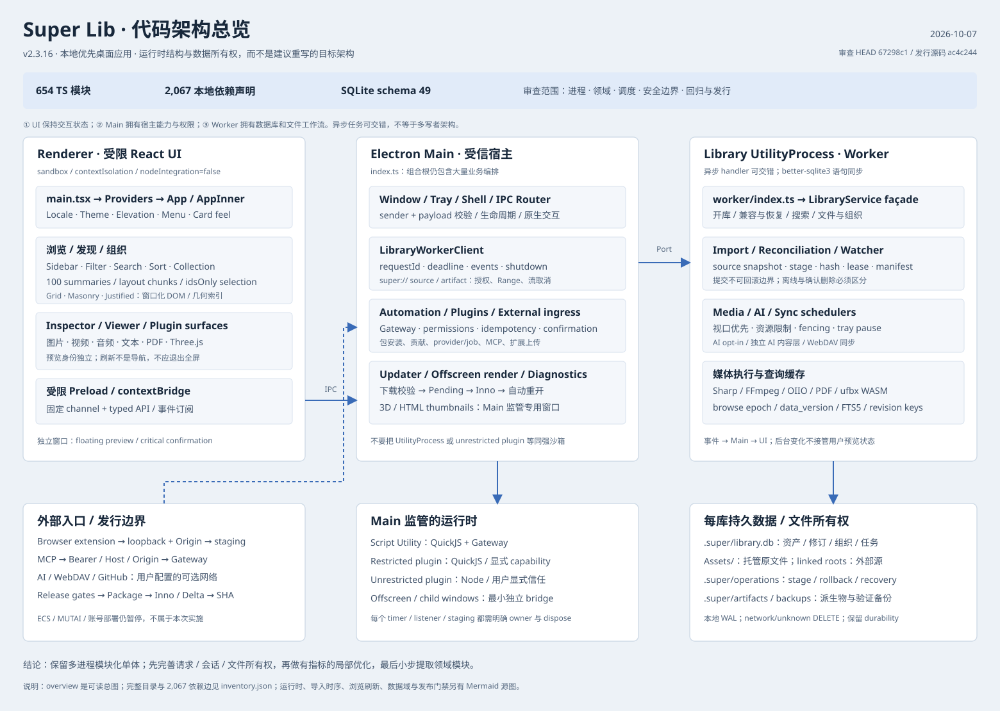

# Super Lib v2.3.16 架构审查

审查日期：2026-10-07，Asia/Shanghai。版本：2.3.16。

实际 HEAD：`67298c17d792070b09adc05d5a3af3cac722ff4f`；发行源码 `v2.3.16`：`ac4c244edd3074b2fc643ddeedf19ab4714fbe65`。HEAD 与发行源码之间只新增发布验证文档。本次未改业务代码、版本、数据库、真实资产库或服务器，未提交、推送或发布。

## 1. 架构结论

当前架构适合这个产品：**本地优先、多进程模块化单体**。React Renderer 负责体验状态，Main 负责宿主能力和权限，Library UtilityProcess 主要拥有 SQLite 与文件工作流，脚本和插件运行时由 Main 监管。不建议为“专业架构”改成微服务、并行 SQLite 写者、统一云端资产库或重新实现整套状态管理。

最应优化的不是技术栈，而是三个所有权边界：

1. **请求和会话**：旧异步请求的清理不能影响新 generation；多选读取必须有界、去重、支持会话失效。
2. **资源和故障**：timer/listener/staging/cache 必须有 owner、容量与 settle/dispose 路径；局部清理失败不能带走整个 Worker。
3. **验收和发行**：近期有效的手工回归应成为可追踪门禁；当前版本产物集合不能依赖临时脚本和人工排除旧包。

文件大说明变更耦合和审查成本高，**不能据此声称软件运行慢**。目前使用体验很好与以下低频边界风险可以同时成立。提速比例、GPU 内存、真实 NAS 及百万级资产表现没有本轮实测依据，不作承诺。

## 2. 范围、证据与限制

- 使用 TypeScript AST 对全部 `src` TS/TSX 做本地依赖清点，审阅关键入口与跨层调用，并行检查前端、Worker、平台/发布边界；主审复核关键代码。
- 版本与 Git SHA 来自本地读取，不重新联网验证 GitHub/ECS 部署。
- [inventory.json](inventory.json) 给出逐文件字节数、物理行数、SHA-256、依赖边、层间矩阵、现有 renderer 构建文件大小。动态 IPC、SQL、插件注入和外部包依赖不靠静态 import 图推断。
- 实际发现分为：**代码可确认的缺口**、**已有最小模型/工具复核**、**需基准验证的优化候选**。没有完成 React 端到端逆序请求复现的竞争，不伪装成已在真实用户现场复现。
- 本轮只运行隔离单元/Worker 回归，不做新成品安装、全量 E2E、真实 NAS、多主机、长时媒体/GPU soak、依赖 CVE 扫描或渗透测试。
- `docs/plans/follow-up-fixes.md` 的 2026-09-14 失败数是历史快照。较新扩展验证记录为 3,124 通过、6 跳过、1 个 FFmpeg/lavfi 造数失败；也不是本轮全量结果。不能把历史失败全说成当前缺陷或已经解决。

### 清点口径

| 范围 | 文件数 | 物理行数 | 说明 |
| --- | ---: | ---: | --- |
| src | 663 | 221,163 | TS/TSX/JS/MJS/CSS 等选定文本；含空行、注释和声明 |
| tests | 592 | 124,339 | 包含测试辅助/夹具代码，不等于 592 个测试套件 |
| extension | 15 | 4,575 | 不包括 HTML/JSON 等未选扩展名 |
| scripts | 47 | 6,219 | 包含 JS/MJS/PS1 等；不统计资源二进制 |

其中 TS/TSX 源模块 654 个、本地 import/export/literal dynamic-import 声明 2,067 条、未解析的相对 TS 模块引用 0。声明数不是独立逻辑依赖数，也不是运行时请求数。

| 集中模块 | 物理行数 | 本地导入声明数 | 职责问题而非性能结论 |
| --- | ---: | ---: | --- |
| src/worker/library-service.ts | 41,049 | 62 | migration、session、导入、查询、组织、恢复、watcher、媒体混合 |
| src/renderer/App.tsx | 12,779 | 198 | 组合界面、会话状态、刷新、动作、任务、预览混合 |
| src/main/index.ts | 8,413 | 103 | 组合根兼窗口、协议、IPC、插件/自动化/更新/入口编排 |
| src/worker/index.ts | 4,453 | 41 | 命令分发兼 AI/媒体调度和渲染 RPC 生命周期 |

物理行数通过换行分隔计算，末尾空行计入，因此可能比编辑器/`Get-Content.Count` 多 1 行。

## 3. 完整结构产物与模块职责



详细源图：[运行时/信任边界](diagrams/runtime.mmd)、[导入时序](diagrams/import-sequence.mmd)、[浏览和后台刷新](diagrams/browse-refresh.mmd)、[数据域/存储](diagrams/domain-storage.mmd)、[发布门禁](diagrams/release-gates.mmd)、[静态层间依赖](diagrams/static-dependencies.mmd)。

```text
Super-main/
├─ src/
│  ├─ renderer/       React shell、发现/画布、Inspector、viewer、UI、i18n/theme
│  ├─ preload/        主窗口与 offscreen/confirmation/floating 独立能力桥
│  ├─ main/           宿主组合根、Window/IPC/protocol、更新、入口、插件/自动化监管
│  ├─ worker/         LibraryService、写协调、导入、查询、watcher、媒体
│  │  ├─ ai/          provider adapter、限流、取消、进度、输入与错误归一化
│  │  ├─ sync/        WebDAV storage、manifest、计划/引擎及本地 library port
│  │  └─ fbx/         ufbx WASM、转换、GLB、模型描述
│  ├─ shared/         request/response/channel、API、领域值与跨进程契约
│  ├─ automation/     command registry/gateway、危险操作 challenge
│  ├─ mcp/            server/tool catalog、授权调用与插件工具
│  ├─ scripting/      QuickJS/script + restricted/trusted plugin utility entries
│  ├─ plugins/        manifest/package/sdk、权限、贡献、provider/job/hook 契约
│  └─ types/          声明补充
├─ extension/         浏览器 background/content、采集目标、save client、菜单
├─ scripts/           开发/ABI/媒体/成品验证、隔离回归与性能夹具
│  └─ release/        pipeline、Inno、delta/baseline、hash、独立 ECS 发布器
├─ assets/inno/       full installer、共享 silent-update-ui
├─ resources/         有锁定来源/哈希的原生媒体资源等
├─ release/baselines/ 不可变按路径/文件 hash 的历史运行时基线
├─ tests/             unit / worker / e2e / 隔离 fixtures
└─ docs/              产品/用户文档、plans、发布证据、本次 architecture 产物
```

### 运行时组件与 ownership

| 组件 | 入口/关键实现 | 拥有的状态/资源 | 跨边界访问 |
| --- | --- | --- | --- |
| 主界面 | src/renderer/main.tsx、App.tsx | browse generation、选择、预览身份、UI 偏好 | 通过 preload API；没有直接 SQLite/任意 Node 权限 |
| Preload | src/preload/index.ts 及 4 个独立桥 | 固定 channel 与事件订阅清理 | contextBridge；不能直接暴露整个 ipcRenderer |
| Main | src/main/index.ts（createMainWindow/浮动预览）、critical-confirmation-window.ts | BrowserWindow、系统交互、缓存、监管器、入口 | 校验 sender/payload；WorkerClient/UtilityProcess |
| Library Worker | src/worker/index.ts、library-service.ts | 每库 connection/session、文件工作流、持久任务 | ParentPort；可请求 Main 代做 offscreen 渲染 |
| Automation/MCP | command-gateway.ts、embedded-mcp-server.ts | execution、权限/确认、幂等/撤销上下文 | 统一经 Gateway 和 Worker adapter，不直接绕开受控库动作 |
| 插件 | package/activation/runtime supervisors | 安装/信任/启用、贡献、jobs/providers、插件存储 | restricted 与 unrestricted 信任边界不同 |
| 媒体 | Worker media lanes + Main offscreen | 子进程/渲染任务、预算、job fence、派生结果 | Sharp/FFmpeg/OIIO/PDF/ufbx、受控 source/artifact URL |
| 更新 | app-update-service.ts、pending-app-update.ts、Inno | 发行清单、下载/cache、pending notice、原用户重开 | 外部 HTTPS + hash；与资产库迁移独立 |
| 浏览器扩展 | extension/background.ts、main/extension-server.ts | loopback 请求和 upload staging | 现有 Origin 校验、不强制配对是产品选择，不在本计划悄改 |

**安全事实**：主窗口 sandbox/contextIsolation 开启、nodeIntegration 关闭；Main 检查 IPC sender；custom protocol 对源路径/修订做授权；插件包有路径/符号链接/解压大小检查；MCP 有 Host/Origin/Bearer 及危险操作确认。UtilityProcess 是进程隔离，不证明其中有 Node 权限的代码具备 OS 强沙箱；unrestricted 插件仍依赖用户信任。

`src/main/window-router.ts` 是已有可测试工具，但没有接入 Main 运行时；现状是主窗口加浮动预览/确认等专用窗口，不是已实现的多工作区路由。

### 数据域与存储

- 每库 `.super/library.db`：library、assets/revisions、组织、人工/AI 信息、派生索引、jobs、file operations/history、leases/change sequence、同步记录、FTS5。
- `Assets/`：库拥有的托管原文件。linked roots 是外部数据，不能当作删除资源库的清理范围。
- `.super/operations`：stage/manifest/rollback/recovery；`.super/artifacts` 等目录放可重新计算的派生内容。
- `.super/backups/library.db.1/.2` 等已验证恢复槽位；恢复必须保护原数据库证据及验证次序。
- Main userData/logs：设备级偏好、插件/脚本状态、诊断、更新缓存；它们不等于当前库 metadata，也不应错误绑定到某个 LibraryService session。

### 静态依赖与逻辑边界

主依赖方向总体符合 renderer/preload/main/worker → shared contracts。发现少量跨目录复用：`main/application-menu.ts:16–18` 引 renderer 的翻译类型/catalog，`worker/library-service.ts:589` 引 renderer/3d-viewer/limits。这些是纯翻译/限制值复用，不是 Worker 调 React，也不是已确认循环故障。中期可放到真正跨层的 shared 模块并保持原路径兼容导出；不能仅按目录名禁用现有安全的纯函数。

## 4. 关键调用链与失败边界

### 4.1 导入

普通文件/目录 staged import：选择/拖放/扩展 → 受控 IPC → prepare → writer lease/heartbeat → 枚举与持久 preparing operation/manifest → 异步 stage-copy/hash及前后 source identity 验证 → conflicts/token → reserve/resolve → 更新 manifest/fence/短事务 → commit → cleanup/完整 scoped summary → push/change-sequence → 媒体/opt-in AI。

Billfish/Eagle 使用128项 bulk adapter、skipContentHash、同步 prepare/resolve并在批间 yielding（library-service.ts:35689起、35990起），不能把普通导入的1MiB异步copy/hash概括为所有导入路径。linked import登记外部目录，ZIP另有解压验证与冲突流程。结果查询内部按500 ID分批，随后合并、按UTF-8全局排序，不截断最终资产数量。

commit 是持久结果边界：后续 cleanup 或结果读取失败不得删除已提交资产。重复确认共享 Promise，过期 token 只失效一次。优化必须保留稳定 assetId/revision、层级、Billfish/Eagle/ZIP 的兼容和冲突语义。

### 4.2 浏览与后台刷新

query/filter/sort/scope → generation → 首 100 summaries + 500-entry layout chunks → viewport destination hydration；idsOnly 支持当前筛选范围全选/反选。后台 watcher/library 变化走 debounce/coalescer；thumbnail/dimensions 为局部 rAF patch；任务状态已 serial polling。AI completed 尚有直接刷新旁路（R09）。

Viewer identity 与请求序号独立于 browse refresh；不能用更换组件 key、重新导航、清 selection 来“简化状态”。

### 4.3 多库与后台工作

Worker 非全局串行 handler：await 期间消息可以交错，SQLite 语句同步；安全靠 connection、短事务、库级写租约、Job lease/fencing。观察器合并 per-library drain；托盘暂停重工作但保留事件；前台恢复 replay。领域事件与 UI toast 必须分开，否则会漏 Main 的缓存、插件、AI 副作用（R05）。

### 4.4 更新与发行

检查清单 → 用户同意 → full/delta 下载/校验 → 解出安装器 → pending/store → silent Inno → 100% 完成提示 → `ExecAsOriginalUser` 带 `--updated` → 窗口关闭；打开失败才显示重试。延期安装需加持久 receipt/恢复校验（R08），不能改变 v2.3.16 自动打开体验。

本地 release pipeline 与 GitHub 上传/ECS 部署是不同步骤。当前 checkout 没有 `.github` 配置，不能把脚本文案中的“same as CI”当作已核验自动 CI。v2.3.16 是经过手工补验的发行，不存在本报告声称的本版漏测事实。

## 5. 风险与优化清单（不是已实施修复）

优先级是后续执行顺序：P1 故障/资源/发布可靠性优先；P2 确定的边界缺口；P3 需测量的局部优化/维护性。静态路径不等于现场发生率。

| ID | 级别 / 证据 | 条件、影响与保行为优化 | 回归要点 |
| --- | --- | --- | --- |
| R01 | P1，代码确认：library-service.ts:6798–6804、6760；windows-fs-retry.ts:100–106 | pending import TTL 回调无 catch，stage 清理最终 throw 可逃逸到 Worker。token 按期失效、清理失败记录并保留恢复证据；不增加 TTL。 | 锁定/EPERM/路径替换；timer 不 throw；Worker 仍响应；重开可恢复；已提交内容不回滚 |
| R02 | P1，代码确认：plugin-github-client.ts:32–55；plugin-package-manager.ts:267；plugin-package.ts:148 | 256MiB archive 限额在完整下载后才生效。Main 收全部 chunks 后再分配等大数组。下载期按实收字节预算终止；取消覆盖 API/commit/download，保留 pause/retry。 | 无/虚假 Content-Length、超限、无 body/fallback、取消、超时；旧插件更新失败不丢旧版 |
| R03 | P2，代码+最小模型：use-browse-pagination.ts:407–419、565–569 | 旧 generation 的 finally 操作 current Set/布尔值，可删除新范围相同 offset 的占位。请求捕获独立 session state，旧 cleanup 不发布新 loading；稳定 App:1045 的失败回调。 | A→B 同 offset、逆序 success/fail、layout 在途；无关 notice 不重建 observer；原尾部加载/定位正确 |
| R04 | P2，代码确认：use-inspector-multi-edit.ts:145–154；use-inspector-asset-metadata.ts:117–118、341；App.tsx:4628–4655 | 大多选 Promise.all 全部发 IPC；cancel 后响应仍回写共享 cache，单选read/save也是cache writer。按session+assetId去重、有界队列，所有writer捕获owner；旧响应不污染新session，entityVersion不倒退；批量listTags一次。版本竞争是待补回归，不宣称现场丢数据。 | 1k冷selection、重复选/反选、同libraryId重开/迟到read与save、旧read晚于新save、mixed/uniform完整编辑 |
| R05 | P2，代码确认：library-service.ts:5984、6053–6062、6159–6166；main/index.ts:1885–1917 | 全 Service watcher suppression 跳过领域事件；库 A 客户端变更可吞库 B 外部变化的缓存/plugin/autoAI 副作用。DB sequence 仍更新，不是丢数据。分离领域变化与 toast suppression，并按库作用域处理。 | 双库与同库混合变更；source cache/plugin/AI 收到事件；通知不重复轰炸 |
| R06 | P2，代码确认：worker/index.ts:251–280、299–326、464–497 | render RPC 正常/timeout 未移除 abort listener，pre-aborted 仍可 post；FBX await 后取消窗口。小型 settle-once helper 清 map/timer/listener；不改协议。 | preabort、success/timeout/abort/重复迟到响应/post 抛错/shutdown；无取消后 offscreen 工作 |
| R07 | P2，代码确认：extension-server.ts:357–400；main/index.ts:1725–1748、1807 | 没库/Worker unavailable 早退绕过 staging cleanup，重复上传残留。唯一 owner/交接、幂等拒绝清理；成功等 Worker 读取结束再删。 | 无库/业务错/异常/成功/取消/并发；不碰非本应用临时文件 |
| R08 | P2，完整性加固：pending-app-update.ts:12–15、65；app-update-service.ts:752、1150；main/index.ts:6173 | 延期更新只复核 path/exists，不持久 extracted installer digest。新 receipt 保存 hash/size，restore/launch 前复验；无可信摘要旧 pending 正常开应用、要求重新准备。不是已证明远程漏洞。 | 字节修改/截断/缺失/链接/旧 receipt/验证期间替换；原用户重开一次，失败重试 UI 保留 |
| R09 | P2，代码确认：App.tsx:3688–3697、3100–3258、5320–5353 | 每项 AI completed 独立刷新第一页、counts、侧栏，旁路 coalescer。统一后台失效入口 one-active+dirty-trailing，保留 AI 字段相关查询正确性。 | 阻塞读取后 burst 100 completions；最终结果/标签/计数/Inspector 正确；4 种 scope 全屏不退出 |
| R10 | P1 发布工程，脚本确认：package.json:49–54；verify-mainline.mjs:10；pipeline.mjs:154 | 默认 E2E 清单没纳入新 filter/preview 等专项，真实 native updater 9 场景靠手动补跑。版本化 gate manifest、统一 runner、capability + 真实状态；不能把 SKIP 当 PASS。 | 清单唯一性/路径可达；Windows 缺 Inno/desktop 明确 blocked；native 只操作隔离 probe；历史失败不伪绿 |
| R11 | P2 发布工程，工具复核：release/lib.mjs:61–89、93；pipeline.mjs:174 | collector扫整个out/make：本地实读265二进制（235 delta），而v2.3.16应选22。唯一target-version artifact manifest供checksum/upload/verify共用，hash stream；构建阶段provenance receipt绑定源码快照与包字节，不能收集时写当前HEAD就当证据；不删历史产物。 | 旧full/delta/异平台/通用安装器混入；错target/source/缺失/重复/hash错；缺凭据或附件不晋升 |
| R12 | P2 优化候选：library-service.ts:6084–6103 | scoped watcher .all 全部活跃资产，再 JS filter。把 managed/linkedFolderIds 参数化条件下推 SQL，先测 trace/EXPLAIN 和行数，不先增索引/改 schema。 | scope/no-scope/ignore/offline/confirmed-delete 一致；20k/100k 单 root 刷新前后比较 |
| R13 | P2 生命周期候选：library-service.ts:5935–5937、23781、23807、40926–40939 | EXR/color-space cache 无容量/关闭库清理；可能随 revision/切库增长，未证明 OOM。有界重算缓存 + ownership 清理，保留 revision/override 失效。 | 命中、驱逐重算、切库、内容替换、override、关闭释放；不删派生文件/metadata |
| R14 | P2/P3，代码确认：app-logger.ts:116–134、158；plugin-package-ipc.ts:549；plugin-activation-coordinator.ts:325 | 日志先同步读完整文件再裁尾 2MB，limit 不限制 I/O/峰值分配；插件贡献热路径无条件同步 debug 写。先做真实 bounded tail read、移除默认 debug I/O；异步写要另测并保退出 flush。 | 100MB 多字节/截断行/并发追加；读取预算；脱敏/关联结果；debug 默认无写，失败不影响业务 |
| R15 | P3，微基准非 UI：viewport-window.ts:111–126；masonry-columns.tsx:253–260；justified-asset-rows.tsx:127–130 | 每次滚动重建 stack heights/map/reduce/从头线扫。纯函数 10k/50k/100k 末端定位均值约0.074/0.513/1.008ms，不是 FPS。几何改变时前缀和，滚动二分；保 overscan/spacer。 | 随机差分含 NaN/负值；深跳/回滚/重排/框选；成品 frame/longtask/白屏才决定启用 |
| R16 | P3 维护性，静态清点：41k Service / 12.8k App / 8.4k Main | 保 façade、组合根、协议，先提取纯 migration/query/value 与 session ownership，再分块 extraction。不按“文件最大”先重写，不能同批替换状态库/多 Worker。 | migration SQL/checksum 逐字一致；边界规则；每切片相关回归与可独立回滚 |

表内位置相对仓库 `C:/Users/Administrator/Desktop/Super-main/src/`（release/lib 和 pipeline 例外为 `scripts/`，package 为根文件）；精确快照 hash 位于 inventory。架构计划逐任务列出完整路径。

### 暂不实施的额外观测项

- PDF 已有 IntersectionObserver、分批 placeholder、Range 读取及取消，并非“所有页立即渲染”。滚动过的 canvas 保留、无 pixel budget 是长文档/GPU 内存候选；需长 PDF+高 DPR/zoom 实测，不能本轮顺手换整套 viewer。
- 3D viewer 已有 DPR≤2、资源 dispose/context lost 处理，但静止状态仍 requestAnimationFrame 连续 render。按需渲染应保 damping/HDRI/theme/resize/阴影更新，先测 idle GPU/CPU；不凭循环存在判严重故障。
- 主 renderer 已动态加载 pdfjs/部分模型模块；现有本地 main JS 931,821 bytes，scene chunk 696,024 bytes。它们是构建产物，不是冷启动时间。按需加载 viewer/dialog 的收益需量启动与首次打开，不盲目降低 chunk 警告门槛。
- 真实 NAS/多 host、unknown journal、新 schema 安全写入能力矩阵是兼容边界专项，不在本轮优化中悄然改变产品策略。

## 6. 必须保留的功能与非功能要求

1. 本体免费、免账号、本地优先；ECS/MUTAI/账号/目录部署暂停，优化不引入云端依赖或新的联网要求。
2. SQLite schema 49；历史 migrations SQL/checksum 不重写，必要新迁移只能经独立兼容审查追加。当前计划默认 **不迁移 schema**。
3. 本地 WAL、network/unknown DELETE、foreign_keys、synchronous=FULL、busy timeout 与 lease/fence 不降级以换速度；事务内不放复制/网络/媒体。
4. current asset/revision identity、人工优先、AI 独立层、sequence/collection/tag/metadata/undo 关系保持；文件与源路径校验不放宽。
5. pending token 单次消费、commit 边界、失败恢复、operation 所有权与 verified backup ladder保持。
6. offline/EPERM/路径祖先替换与确认删除继续区分；linked roots 不属删除库的目标。
7. 搜索范围/单字包含/AND-OR-排除/排序、滤镜包含排除、完整全选反选、分页最终完整性保持，不能用结果截断降低负载。
8. background/AI/磁盘通知不退出当前查看/全屏；用户显式导航才改变上下文；保持缩放锚点、预览切换、主题/语言/快捷键。
9. 自动更新仍在100%后提示并自动原用户打开一次，窗口自动关闭；真实失败才重试，fresh install 不强改为同一流程。
10. Desktop newer/stuck schema 的现有行为**不是自动只读**（library-service.ts:38934–38982）。stuck 不启动当前 schema watcher/jobs；仅 explicit read-only inspection 无迁移/恢复/observer。计划保持现行为，有争议能力单独评估。

### 性能验收（待执行，不是当前达标声明）

- 同一机器、同一 deterministic fixture、同样热/冷状态、禁止并发构建/基准互相污染；记录环境、数据规模、样本数、p50/p95/max、失败与 skip。
- correctness 是硬门槛：旧/新有序 ID、过滤/metadata/恢复结果逐项相等。p95 非退化建议预算≤基线110%，至少30样本；基线<5ms时加绝对2ms噪声容差，仅用于同 fixture 判定。
- 去重复读取以**请求/SQL 数量预算**验收，不只用平均耗时：AI burst one-active+one-trailing，多选明确 in-flight 上限且最终完整，scoped watcher只读目标范围，render RPC settle 后无存活 timer/listener/map。
- 大库20k/100k、1k cold selection、64MiB内容更新、长日志、大插件流使用隔离 fixture；真实 NAS/GPU 单独列 not-run，不把模拟结果充作真实设备指标。

## 7. 推荐路线与 ADR

比较三条路线：

| 路线 | 收益 | 风险/成本 | 判断 |
| --- | --- | --- | --- |
| A：修边界+测量+渐进模块化 | 可复现缺口先消除，保持体验，回归与回滚清晰 | 需补异步/生命周期测试，拆分不会一次“清爽” | **推荐** |
| B：只做缓存/并发/预加载调参 | 部分路径可能短期变快 | 掩盖 ownership、增加排队/资源占用，易影响旧语义 | 不作为主线 |
| C：全量重构 App/Service、换状态库、多 Worker/DB | 理论职责更整洁/吞吐更高 | 数据恢复、查询一致性、历史库、插件 API 回归成本大；当前无测量理由 | 暂不采用 |

[ADR 提案](adr-proposals.md) 记录 ownership、gate/artifact、保 façade 与基准先行等取舍，状态均是 Proposed。用户本轮要求产出计划，不等于这些设计已获实施批准。

## 8. 下一步与本轮验证

先在 Codex 计划模式读取 [执行计划](../../plans/2026-10-07-architecture-optimization.md)，将阶段 A 的确定性复现/门禁/局部故障隔离拆成独立步骤；确认后逐项执行。阶段 B 先量后优化；阶段 C 提取模块必须在前两阶段稳住后开展。不要把所有发现塞进一个“大重构”提交。

本轮 fresh 回归结果与命令见 [verification.md](verification.md)。现有相关测试通过不代表新增故障条件已经被覆盖或修复。业务代码没有变化，因此不是一次优化发布，也没有授权更新旧 ECS。

## 9. 外部技术依据（仅支持机制，不替代本项目证据）

- 保持 sandbox/contextIsolation、校验 IPC sender 与限制外部能力：[Electron Security](https://www.electronjs.org/docs/latest/tutorial/security)。
- 库进程由 Main 监管、通过消息通信：[Electron utilityProcess](https://www.electronjs.org/docs/latest/api/utility-process)。不由此推断 unrestricted Node 插件是强沙箱。
- 日志尾读使用受控位置/长度，异步 FS 写需显式排序和错误处理：[Node.js File system](https://nodejs.org/api/fs.html)。本项目真实导入/运行时 Node 版本仍以 package/锁定 Electron 为准。
- 外部提交缓存一致性保留同一 connection 的 data_version 观察：[SQLite PRAGMA data_version](https://www.sqlite.org/pragma.html#pragma_data_version)。不跨连接比较数值，也不手写 schema_version。
