# Super Lib：阶段 A 实施结构与验收索引

这是 2026-10-08 的实施增量，不替换 [2026-10-07 完整审查快照](../2026-10-07-review/README.md)。原快照的清点 SHA、统计、SVG/PNG 和 Proposed ADR 保持历史意义，不能当作现在源码仍未改变。当前版本已由根任务提升至 2.3.17，package/lock 仅提升根版本、未升级依赖；用户已明确授权打包并发布 GitHub 与旧 ECS 自动更新源。真实成品与实际发布结果由根任务另行登记，不因授权或版本提升而记为 PASS。

阶段 A 实施及限定检查点已完成：A4/A5/A6/A7 App 接线与 A1b 末端源码漂移修复均已冻结。根任务默认并行执行的 `checkpoint-contract-final.json` 为 71 文件、1152 PASS / 0 FAIL / 1 平台不适用 SKIP，实际 exit 0；A1b 最终七文件166 PASS。UI21、媒体8、版本17 fresh UtilityProcess探针1、fresh native九场景，均exit 0；严格typecheck/lint/diff/extension通过。SVG/PNG与离线页面实际渲染验收、1490文件全源SHA及16本地链接通过。实际包7992文件、Forge与Inno均已构建成功，实际成品四项基础/筛选E2E通过；增量与远程发布结果由[本版验证记录](../../releases/v2.3.17-validation.md)登记。历史失败保留，限定通过不扩大成历史全量套件或性能证明。具体证据见[持续台账](../../plans/2026-10-08-architecture-stage-a-continuation.md)、[兼容矩阵](compatibility-matrix.md)。

离线结构产物：[浏览索引](index.html)、[完整 SVG](architecture-overview.svg)、[PNG 预览](architecture-overview.png)、[运行结构 Mermaid 源](diagrams/runtime.mmd)。SVG/PNG 与页面已实际渲染验收；Mermaid 源未运行引擎渲染，不伪称验证。结构说明不代替代码门禁与最终源码清点。

## 约束与非功能要求

- 保留本地优先、多进程模块化单体；不换状态框架、数据库或 writer 拓扑。
- 保持资产/修订/路径身份，人工与 AI 元数据分层，以及搜索、筛选、全选、反选、多选完整目标集合和全屏预览身份。
- 可靠性目标是确定性的终态清理、旧请求隔离、原始请求预算和可诊断失败，不是承诺同步 SQLite/GPU 工作能被物理取消。
- 不修改 schema49、foreign keys、WAL/DELETE 选择、synchronous FULL、租约 fencing、事务与验证备份恢复策略；不扩展外部 linked root 删除所有权。
- 没有新 p95/FPS/大图库收益承诺；B/C 的 SQL、几何索引、日志预算等测量优化另行确认。
- 构建 receipt 只证明本地输入与输出的关联，不替代数字签名，也不解决同用户恶意进程的最终执行竞争。

## 进程与拥有者结构

```mermaid
flowchart TB
  subgraph UI[Renderer sandbox]
    APP[App 组合与用户界面]
    PAGE[分页 owner / generation\n100 summaries + 500 layout chunks]
    META[metadata-read-controller\nopaque session + asset epoch\n4 raw slots / 3 bulk slots]
    INS[单选 / 完整多选 Inspector\nconfirmed baseline ≠ 未提交草稿]
    VIEW[Viewer 身份 / request sequence]
    REFRESH[已有 coalescedRefresh\none active + dirty trailing]
    HYDRATE[content-hydration\n计数 + sidebar raw reads 排空]
    NOTIFY[独立 watcher 通知候选\n领域事件不因静音丢失]
    APP --> PAGE
    APP --> INS
    INS --> META
    PAGE --> VIEW
    APP --> REFRESH
    REFRESH --> HYDRATE
    APP --> NOTIFY
  end
  PRELOAD[contextBridge typed 白名单 API]
  subgraph HOST[Electron Main]
    MAIN[index 组合根 / sender 与 payload 校验]
    WORKERCLIENT[LibraryWorkerClient\nrequest deadline ≠ actual terminal]
    PUBLISH[asset-change-publisher\ncache / plugin / opt-in AI / renderer]
    STAGING[ExtensionServer + upload staging\nclaim → dispatch → actual terminal 释放]
    RPC[受控 offscreen BrowserWindow\n3D / HTML thumbnail bridge]
    PLUGIN[插件包管理 / 信任 / 激活\n流式字节预算 + pause/cancel 链]
    UPDATE[PendingStore + AppUpdateService\n下载生成 receipt / 最终 installer guard]
    GATEWAY[CommandGateway / ExecutionJournal\nMCP / 确认 / 幂等 / 库上下文]
    PROTOCOL[super:// 与 plugin 协议\n授权源 / Range / 流取消]
    MAIN --> WORKERCLIENT
    MAIN --> PUBLISH
    MAIN --> STAGING
    MAIN --> RPC
    MAIN --> PLUGIN
    MAIN --> UPDATE
    MAIN --> GATEWAY
    MAIN --> PROTOCOL
  end
  subgraph WORKER[Library UtilityProcess]
    ENTRY[worker/index typed dispatcher]
    SERVICE[LibraryService façade\n每库 session / 查询 / 导入 / watcher]
    RENDER[pending-render-rpc × model/document\nsettle once + orchestrator abort checkpoints]
    MEDIA[媒体队列 / 优先级 / job fence\nSharp / FFmpeg / OIIO / PDF / ufbx]
    AI[AI provider 队列 / limiter / opt-in]
    SYNC[SyncEngine / WebDAV]
    ENTRY --> SERVICE
    ENTRY --> RENDER
    ENTRY --> MEDIA
    ENTRY --> AI
    ENTRY --> SYNC
  end
  subgraph DATA[本地持久数据与文件所有权]
    DB[(每库 .super/library.db\nschema49 / FTS / change sequence)]
    FILES[Assets 托管原文件\n外部 linked roots 不属库所有]
    DURABLE[operations / revisions / history\nartifacts / verified backup ladder]
  end
  SCRIPT[隔离 UtilityProcess\nScript / Restricted QuickJS / Trusted Node Plugin Host]
  CHILD[Floating preview / 危险确认子窗口\n独立窄 preload]
  EXTERNAL[可选 AI / WebDAV / GitHub / 更新下载源]
  APP <-->|固定 IPC 与事件| PRELOAD
  PRELOAD <--> MAIN
  WORKERCLIENT <-->|ParentPort / requestId| ENTRY
  SERVICE <--> DB
  SERVICE <--> FILES
  SERVICE <--> DURABLE
  RENDER <--> RPC
  GATEWAY <--> SCRIPT
  PLUGIN <--> SCRIPT
  MAIN <--> CHILD
  STAGING --> WORKERCLIENT
  PROTOCOL --> WORKERCLIENT
  GATEWAY --> WORKERCLIENT
  SERVICE -->|真实领域变化 / 可选静音提示位| PUBLISH
  PUBLISH --> APP
  AI --> EXTERNAL
  SYNC --> EXTERNAL
  PLUGIN --> EXTERNAL
  UPDATE --> EXTERNAL
```

图中 Main/UtilityProcess 之间的业务边表示实际消息链，不是所有节点直接跨进程调用；具体 bridge 由 dispatcher/WorkerClient 组合。Mermaid 源作为可审结构说明，尚未运行 Mermaid 引擎渲染/语法门禁。原审查提供的 [数据关系图](../2026-10-07-review/diagrams/domain-storage.mmd)、[导入序列](../2026-10-07-review/diagrams/import-sequence.mmd) 和 [本地静态依赖快照](../2026-10-07-review/diagrams/static-dependencies.mmd) 保留，未改的持久数据关系仍适用；静态依赖统计不是当前清点。

## 文件与切片映射

| 切片 | 实际生产边界 | 已有证据与最终剩余 |
| --- | --- | --- |
| A0/A1a | `scripts/release/gate-manifest.mjs`、`run-gates.mjs`、mainline/pipeline/run-e2e | 单一显式门禁、五态和 capability 已实施；冻结后默认并行联合 71 文件 1152 PASS / 1 平台 SKIP、exit 0；严格静态门禁通过 |
| A2 | `LibraryService.scheduleImportExpiry` | TTL callback 故障不复活 token；2.3.17 fresh UtilityProcess probe 1 PASS、exit 0，[新 GUID manifest](../../../tmp/architecture-stage-a-c48189bd-9349-4c29-b1b3-07179be1eda1/import-expiry-probe/manifest.json)记录 source/compiled hashes，不复用旧包 |
| A3 | Main 插件 client / install operation / package manager | 接收前 bytes 上限、pause/abort/deadline、update/fallback 链已验证；不称 256 MiB RSS 上限 |
| A4 | `use-browse-pagination.ts` | 实施与 App 接线已冻结；真实 hook 34 项通过，旧 finally 只清自己的占位；本轮 UI 检查点 21 项通过，不等同于大图库性能测量 |
| A5 | `metadata-read-controller.ts`、两个 Inspector hooks、相关 cache writers | 实施与 App 接线已冻结；83 项复核通过，保全选、旧 owner/raw slots、dirty draft、真实 undo/redo 与来源呈现；本轮 UI 检查点已通过 |
| A6 | Service per-library quiet hint → strict protocol → `asset-change-publisher.ts` → Renderer presentation | 全链接线已冻结；非 App 179 项与联合 A7 最终 100 项通过，领域快照/提示候选分离；UI 检查点已通过 |
| A7 | `content-hydration.ts` + 既有 coalescer + App 两个 AI full-refresh 入口 | 实施与 App 接线已冻结；导航/租约与本地移除真实 red 后最终六文件 100 PASS、exit 0；UI 检查点 21 PASS、exit 0 |
| A8 | `pending-render-rpc.ts`、`model-render-orchestrator.ts`、实际 worker wiring | 各终态 cleanup、迟到回复和 abort checkpoint 已验证；fresh model-thumbnail/model-viewer 媒体检查点 8 PASS、exit 0，不是取消已运行 GPU/共享转换 |
| A9 | `extension-upload-staging.ts`、Server/Main/WorkerClient terminal | 不按 deadline/disconnect 删后台源；实际终态/origin契约纳入最终默认并行联合回归，不冒充扩展→生产 Worker 完整 E2E |
| A10 | `pending-app-update.ts`、`app-update-service.ts`、Main 薄 resume/launcher | 60 项通过；版本17 native九场景实际PASS/exit0，保自动打开与失败重试；隔离probe不等于运行用户安装器 |
| A1b | `build-provenance.mjs` → 薄 launcher/Forge hooks → exact artifact manifest | 七文件最终166 PASS/exit 0；实际包7992文件、Forge skip-package/make、Inno与完整ZIP已生成验证，历史增量/远程发行见本版记录 |

## 决策状态与取舍

原 ADR 不做历史回写。本轮采用的 A01/A02/A03/A04 范围由决定版与用户继续实施授权限定；具体测试状态不因采用设计而自动变成 PASS。A05 的测量后性能方案仍延后。

- 不可复用 session token 与每资产 epoch 增加局部状态机，但同时隔离库关闭/同 ID 重开、旧读、已提交保存。逻辑取消保留 raw IPC 槽，可能让新界面短暂等旧请求结束，这是守预算的真实代价。
- metadata 的版本回退只在显式成功历史恢复后重置读取基线；普通失效保留防倒退要求，独立 VERSION_CONFLICT 最低版本仍保留。history 没有 affected IDs，因此本地已缓存/活动 scope 需要重读，不擅改公共响应。
- 领域事件与通知呈现分离增加内部事件数量；复用现有 debounce/coalescer 抑制重复工作，不靠吞领域事件实现降噪。
- 背景 full refresh 等全部 count/sidebar 原始 Promise 排空；前台首屏和 loading 仍先完成。不能以 fail-fast aggregate 释放活跃租约，也不缩减 AI filter/rating/tag 依赖换取测试通过。
- legacy pending 没有可信 receipt 时正常打开软件并要求重新准备，放弃“补 hash 自证”自动安装体验；最终校验不是签名或强对抗沙箱。
- 输入快照/最终包 receipt/唯一附件清单是不同阶段；不清旧 out、不按当前 HEAD 追认历史包，旧不可变 delta source baseline 保留。

## 回滚与交付边界

各切片按局部可审 diff 回滚，顺序逆依赖：A1b 消费者/入口/纯 contract；A7 接线/helper；A6 呈现/严格可选字段/publisher；A5 hook/writer/controller；独立 A4/A10/A9/A8/A3/A2。回滚只撤本轮对应改动，不使用 `git reset --hard`，不删除用户既有 dirty 文档、图库、旧 out 或 baselines。

恢复旧来源判断或取消保护不是“旧路径已安全”的证明；回滚之后仍需对应门禁。具体动作应由实际 patch 与证据确认，不能整文件覆盖长期未提交的用户改动。

当前已登记阶段A限定验收及实际成品构建/基础回归；发行输入与输出关联见本版验证记录。全源快照1490文件 fingerprint为`977b76babc85296270380a1e5c23e6d829cb1c3cd28e84c417b7400b738e1165`，对应发行源提交4516e0a。不会推进B/C、ECS迁移或账号服务；不运行用户安装器。实际GitHub与ECS更新源晋升必须核远程附件，不能由本地fixture或授权推断。
