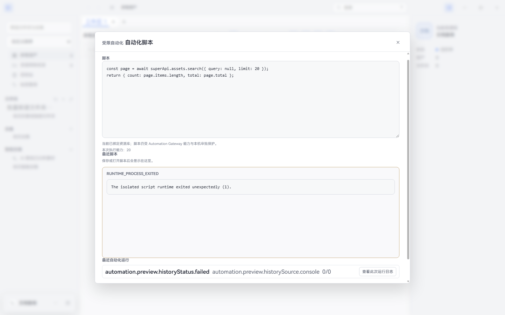

# Super Lib 已知问题与验证边界

更新日期：2026-10-11；K01 原运行复现为 2026-10-10 的 2.3.18 成品，以下不反向改写该证据。本页区分真实失败及尚未运行的专项场景。历史 U01–U08 的原复现记录保留在 [修复前快照](../plans/confirmed-unfixed-2026-10-09.md)，2.3.18 的已交付修复见 [验收记录](../releases/v2.3.18-validation.md)，后续 2.3.19 的实际范围见[新验收](../releases/v2.3.19-validation.md)。本页不是穷尽所有可能缺陷的承诺。

## 本轮实际复现、仍未修复

| ID | 问题 | 成品结果 | 当前处理 |
| --- | --- | --- | --- |
| K01 | Windows 2.3.18 自动化 Console 缺少运行依赖 `typescript` | 只读 `assets.search` 示例失败，`RUNTIME_PROCESS_EXITED`，子进程退出码 1 | 2.3.19 没有修复此依赖路径；指南继续注明执行受阻，不用其他门禁通过关闭它 |

2026-10-10 20:07:52（北京时间），运行本地已验收的 `out/Super-win32-x64/Super.exe`；身份检查为 `version=2.3.18`、`packaged=true`。使用独立 userData 和临时空库，没有接触用户真实库。只批准这一次只读脚本运行确认：

```ts
const page = await superApi.assets.search({ query: null, limit: 20 });
return { count: page.items.length, total: page.total };
```

实际 UI 显示 `The isolated script runtime exited unexpectedly (1).`；会话日志的 `automation.runtime.stderr` 明确为 `Error: Cannot find module 'typescript'`，require stack 指向 `.vite/build/script_runtime_utility.js`。该成品中仍存在 `require("typescript")`，但 `resources/app/node_modules/typescript/package.json` 不存在。此前 2.3.17 的同类失败在当前版仍成立。



图片来源与校验见 [拍摄记录](../assets/ui/review-2.3.18/README.md)。本地诊断结果保存在被 Git 忽略的 `tmp/docs-review-console-aYje6q/`，公开文档不包含用户真实路径或凭据。

建议后续修复：将运行时转译依赖正确打包或构建时消除该动态依赖；以最终安装目录的成品执行只读脚本、写操作确认、异常、取消和退出重启，再重新发行。现有开发测试及发布门禁通过，没有覆盖这个实际 Console 运行路径；不能用其通过结果关闭 K01。普通导入、浏览和查看器无需 Console。

## 2.3.19 侧栏加载回归：源码已修复，尚未重新发行

K02：用户更新至 2.3.19 后，画布已有资产但目录、合集及 Inspector 统计长时间为空。只读核对确认库中组织数据仍在。真实隔离 Windows 成品测试复现：恢复非默认排序触发新搜索时，原侧栏补充读取被前台查询 generation 判为过期；整批等待以及单个 transport 失败也会阻止成功列表发布。

当前源码已把全库组织、全库计数与画布查询的所有权分离，逐字段发布并优先提交导航请求；库切换、同 ID 重开、新刷新和 React 队列更新的保护仍保留。另修复了筛选页总数误写为全库数量的关联问题。164 项相关单元、8 项串行真实窗口回归通过，详见[复现、方案与验证记录](../plans/2026-10-11-sidebar-hydration-recovery.md)。没有修改用户真实库、重建索引或扩大超时。

修复尚未打包进新安装器。原 2.3.19 成品、基线和 ECS 附件不包含此修复，GitHub 2.3.19 保持草稿，不将源码通过写成已经交付。

## 验证范围更新

2.3.19 实际成品核对：仍含 `script_runtime_utility.js`，其 `resources/app/node_modules/typescript/package.json` 不存在；本轮 8 项成品回归没有执行 Console 脚本，因此不把静态核对冒充再次运行复现。K01 保持开放。

| 类型 | 范围 | 当前结论 |
| --- | --- | --- |
| 已有局部专项运行 | 全屏上一张/下一张、查看器删除 | 2.3.19 的真实 Windows 成品查看器组合通过；后台刷新在四种浏览范围通过，不能扩展为所有平台、所有删除权限和特殊素材 |
| 仍有专项边界 | 链接重复内容／新序列的所有交互组合 | 保留既有确认与保护；单元和本轮窗口场景不替代所有组合、外部盘或新行为的运行对照 |
| 外部服务验收缺口 | 真实多设备/多写者 WebDAV、NAS 离线重连、真实 AI 供应商、第三方插件及 MCP Agent | 本地/Mock 通过不能自动扩展为所有服务通过 |
| 平台/交付范围 | macOS 成品；浏览器商店/可直接安装扩展附件 | 本轮 2.3.19 构建和验收为 Windows x64，实际发布状态见发行验收；扩展保留内部开发态 |
| 暂停范围 | F15 账号、官方插件目录与社区、ECS 迁移 | 用户指示暂停，不列为已实现 |

操作指南入口：[安装](../user-guide/installation.md) · [同步](../user-guide/sync.md) · [自动化](../user-guide/automation.md)。
