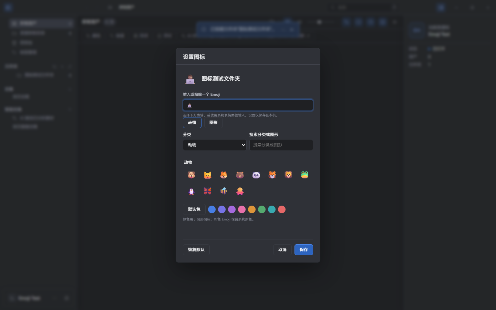
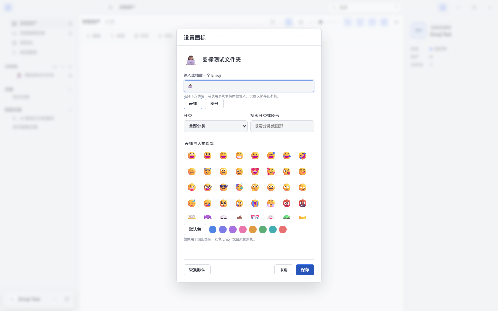
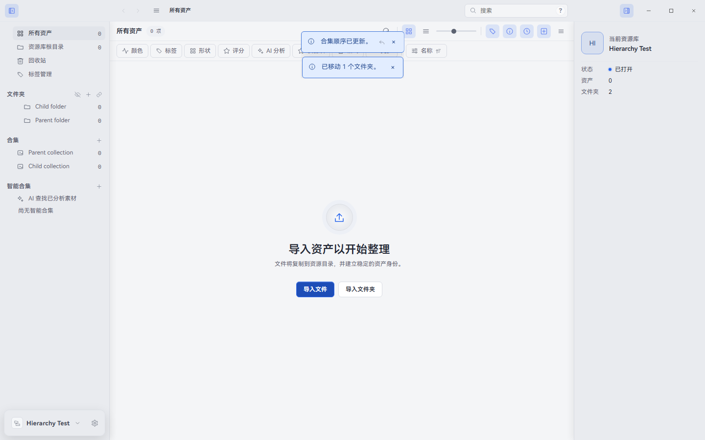

# 软件本体升级：首批结果（2026-10-10）

> 历史首批检查点，不覆盖当时待办；后续已继续实施，最新状态见[本体补齐结果](completion-results-2026-10-10.md)。

本轮用户授权补齐软件本体，并明确 **F15 云端账号/官方目录/ECS 继续暂停**。当前仍为版本 **2.3.17 工作区源码**，没有打包、安装、提交、Git 推送、GitHub Release 或 ECS 操作。上一轮未提交修复、README 署名与 MIT 保留；本页是实施检查点，不是“F01–F14 全部完成”的发行说明。

基线提交 `6dc9ab07eed3b6a0e58c3481397c9823d2bd7bc2`；[阶段 1 证据](followup-phase1-evidence-2026-10-09.json)保持其原时点，不能因本轮源码哈希变化被冒认为当前输入。历史 HTML 的 349 对话/52 版本/30 决策见[后开发决策](../POST_DEVELOPMENT_DECISIONS.md)；本轮不伪造新的 HTML 编号或发行版本。

## 已落地内容

| 项目 | 实际改动 | 验证与保留边界 |
| --- | --- | --- |
| 用户问题 1：图标选择 | 借鉴 Serpent 0.2.9 `f58701a6` 的 11 类、200 个 Emoji；支持分类、分类/图形名称搜索、24 个现有内置图形和 8 个颜色、即时预览/空结果/重置 | 手动粘贴复合 Emoji、肤色/旗帜保留；图形/颜色白名单；不用任意远程 SVG。仅本机偏好，不声称等于上游全部图形或 workspace 外观 |
| 旧图标兼容 | 新 v2 外观偏好合并只读 v1 Emoji；按库/条目隔离，重置墓碑防止旧图标复活 | 不删除/改写 v1，不改物理文件名/库表；存储失败显示错误，旧偏好保留 |
| 用户问题 2：文件夹提升层级 | 左侧直接子项落到父项→提升一级；父项顶层→根目录；批次直接子项采用同一规则 | 仅侧栏启用，资产网格原“放入该文件夹”不变；继续走 Worker 的移动/冲突/历史管线。自项/后代/未知 ID 拒绝；坏循环事实不会让检查无限循环 |
| 合集层级 | 接通已有 `parentId` 协议→Preload→Main→Worker，直接父项提升、其他跨级移动；合集标题可作根级落点；同级继续重排 | 资产拖入合集仍为加入资产，不混作合集移动；Worker 防自项/后代循环，历史可撤销/重做 |
| 相关撤销缺陷 | 子合集的单行快照没有未修改的父项，原恢复算法错误要求其也在快照；现在读取同库已有父项，快照内父项必须先恢复 | 真实提升/撤销/重做、成员保留通过；不靠删成员/删历史绕过错误 |
| F01：JFIF / AVIF / FLV | 共享注册/MIME/格式筛选、缩略图队列和 AI 视频可视路径统一；JFIF 用 JPEG 解码、AVIF 用 sharp，FLV 走视频海报与现有按需代理回退 | 不预转码所有视频；真实文件 Worker→缩略图→预览及 Electron 原图/FLV 回退解码通过。不是支持任意 AVIF/FLV 编码变体的保证 |
| README 对照 | 中英 README 下方新增功能与性能表，署名仍放结尾；固定版本对比，继承功能/差异化增强/未完成分开 | 69.7→13.7 ms、17.26% 瘦身与一次 delta 数据为 Super 历史自身对照；未测同机 Serpent 性能，不写全面超越 |

### 本轮真实界面

图片来自当前源码的独占 Electron 进程和临时库，不读取运行版图库/偏好；不是安装包截图。

## 尚未完成的功能清单

| ID | 当前状态 | 后续验收范围 |
| --- | --- | --- |
| F01 | 本批完成并验证 | 更多真实编码/超大图及成品平台回归属于发布验收 |
| F02 | 未实施 | 任意颜色/相似度、包含/排除、持久筛选；U03 中性保护不等于任意色能力 |
| F03 | 未实施 | 嵌入封面/波形偏好、hover scrub、播放体验 |
| F04 | 未实施 | GIF 控制、0.25–4 倍速、逆向旋转、4K 缩放 |
| F05 | 未补齐 | U06 已有安全解码/编码提示；自动折行和明确原编码保存仍待做 |
| F06 | 未实施 | TTF/OTF/WOFF/WOFF2/TTC 资产分类、字体预览与卸载 |
| F07 | 未实施 | 文件夹 Inspector 封面/统计/路径/大小与离线边界 |
| F08 | 部分完成 | 图标/颜色、根级拖放和原同级重排已做；排序入口与侧栏名称过滤仍待做 |
| F09 | 未实施 | 独立工作区标签、各自历史/预览/筛选/滚动 |
| F10 | 未实施 | 区分 AI 生成/已分析、嵌入信息、搜索历史/多标签 |
| F11 | 未实施 | 忽略规则预览、批量目录/展开/跳转等价入口验收 |
| F12 | 未实施 | AI 标签/描述元数据同步、变更防抖自动上传与状态；路径移动已做不代表此项完成 |
| F13 | 未实施 | 明确旋转/翻转写回、确认/备份/撤销/元数据保留 |
| F14 | 未实施 | 大内容分块、RPC/队列预算和取消/崩溃恢复 |
| F15 | 用户明确暂停 | 不部署官方目录/账号服务/ECS |

不把上轮八项修复、某个入口接通或小样本测试绿灯计算成“新增功能全部完成”。实施顺序及检查点见[本轮计划](../plans/2026-10-10-local-upgrades.md)、[完整分阶段计划](../plans/2026-10-09-followup-upgrades.md)。

## 自动化验证与真实限制

- 本批扩大原生 Vitest：14 文件 **256/256 通过**；单独上游审计轨道 **10/10 通过**。两个轨道用例分开列，不与阶段 1 的历史 692 项重复累加。
- 当前源码真实 Electron：**3/3 通过**。图标分类、搜索、颜色、复合 Emoji、重开持久化、重置、焦点循环/返回、Escape 和暗亮主题；文件夹/合集直接父项到根级；JFIF/AVIF 原图解码、FLV 自动回退到可解码代理。不是仅查扩展名或一个可见 DOM。
- 类型检查与所修改 TypeScript 的 ESLint 通过。Vite 保留大 chunk 提示；App/LibraryService 仍为大文件，本轮不把它们当作已拆分。
- 文档审查脚本 5/5 通过；包含新增未提交文件的 148 份 Markdown、617 个本地引用、69 个图片引用核对为 0 断链。未执行要求进 Git index 的发布门禁，因为本轮未提交/推送。
- JSON 复测曾在所有 256 断言通过后，于 Windows 原生退出阶段报 `PostQueuedCompletionStatus(6)` 并退出 1；没有当成整条命令成功。随后 14 文件串行原生复测仍为 256/256，并干净退出 0；保留此环境退出不稳定记录，不宣称修复了原生运行时。
- 测试初轮发现合集撤销失败后真正修复；真实 FLV 夹具不能用本机 FFmpeg 缺少的 lavfi，改用真实 PNG 输入；RAW 回归断言仍是 v1 generator，而阶段 1 修复已升 v2，更新断言并保留尺寸/元数据检查。
- 媒体 E2E 初次未配置专用导入夹具、随后误选隐藏占位图；修正测试实例输入与实际原图选择器，未改产品或弱化解码/原图/代理断言。侧栏 E2E 的打开库按钮在工作区不存在，改为重载仅测试 Renderer 获取其自建条目。
- 未操作真实 WebDAV/NAS/AI 服务、用户数据、已安装程序或 ECS。未测上游同机 FPS/RSS、慢盘峰值、macOS、所有编码变体、真实发布安装。
- 偏好为本机存储，不随库同步；图形颜色不重新染色系统彩色 Emoji；图库 schema v50 是阶段 1 追加迁移，本批未追加/改写数据库迁移。

机器可读[验证与输入证据](local-upgrades-evidence-2026-10-10.json)；截图来源见[图片说明](../assets/ui/local-upgrades-20261010/README.md)。
