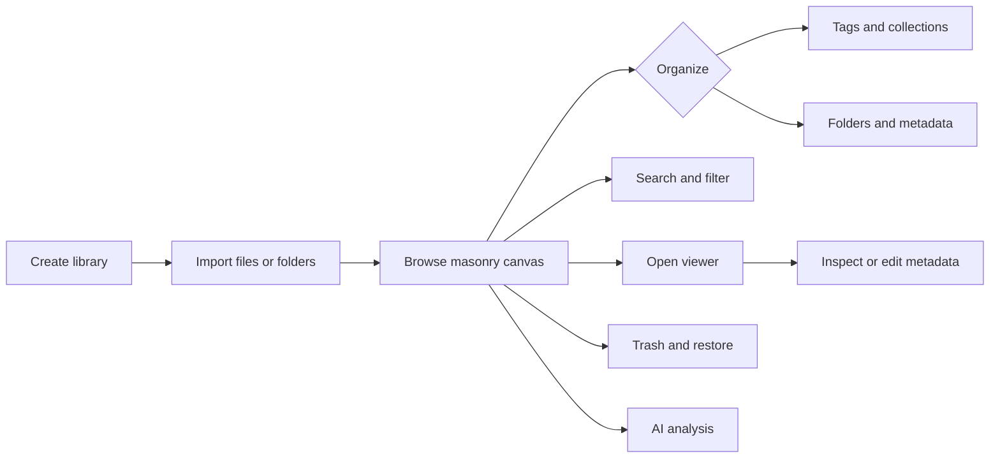

# User Guide

A Super Lib v2.3.18 guide for end users, reviewed against release source, attachments and selected packaged checks on 2026-10-10. See the [illustrated feature catalogue (Chinese)](features.md). Chinese index: [README.md](README.md).

Popular pages: [Quick start](quick-start.en.md) · [Appearance](appearance.en.md) · [Floating preview](basics.en.md#floating-image-preview) · [Corner hint bubble](basics.en.md#hover-hints) · [AI analysis and search](ai.en.md) · [Troubleshooting](troubleshooting.en.md)

- [Quick start](quick-start.en.md) — install, create a local library, optionally configure AI and appearance
- [Install](installation.en.md) — Windows installation, updates, and other platforms
- [Basics](basics.en.md) — libraries, importing, browsing, organization, file actions, and the viewer
- [Search and filters](search-and-filters.en.md) — advanced query syntax, filter dimensions, and Shift multi-select
- [WebDAV cloud sync](sync.en.md) — server configuration, library binding, auto-sync, opening remote synced libraries
- [AI analysis and search](ai.en.md) — manual/automatic analysis, re-analysis review, natural-language search, and smart collections
- [Appearance](appearance.en.md) — color modes, backgrounds, text size, and depth
- [Using plugins](plugins.en.md) — install, enable, update, and uninstall plugins
- [Automation](automation.en.md) — automation scripts and MCP client connections
- [Troubleshooting](troubleshooting.en.md) — common problems and fixes

## Quick start

1. Download `SuperSetup.exe` from the [latest release](https://github.com/aimtowin/Super/releases/latest) and install it.
2. Create a library on a local disk; an SSD is recommended.
3. Optionally configure **Settings → AI** and **Settings → Appearance**.
4. Import assets or link an existing folder, then browse and organize. Double-click to open the viewer; right-click for more actions.

Super Lib is free. Third-party AI providers may charge separately. See the [quick start](quick-start.en.md) for details.

Data stays in your local library directory; for syncing across machines, use WebDAV cloud sync (see [Sync](sync.en.md)).

## Interface at a glance

A typical workspace has library navigation on the left, the asset canvas in the center, and the Inspector on the right. On Windows, the upper-left Main menu contains File, Edit, Window, Library, and Settings; macOS also exposes the same commands in the native menu. Import, search, filtering, and sorting stay in the top toolbar.

See [Basics](basics.en.md) for the complete workflow.

## Documentation status

This directory describes the current user-facing product. Screens and available features can change between releases; follow the latest installer and release notes.

The `live-2.3.17/` images are real captures in an isolated fixture library. External services were not connected; native update images are safe previews. These are not proof that every codec or external integration passes end-to-end testing. Older records remain historical snapshots.

Current evidence: [2.3.18 acceptance](../releases/v2.3.18-validation.md), [known issues](../reference/known-issues-2.3.18.md), [Serpent 0.2.10 comparison](../reference/comparison-2.3.18-serpent-0.2.10.md). The catalogue labels 2.3.18 development captures separately. Packaged Console execution is currently blocked; ordinary import, browsing and viewing do not require it.
